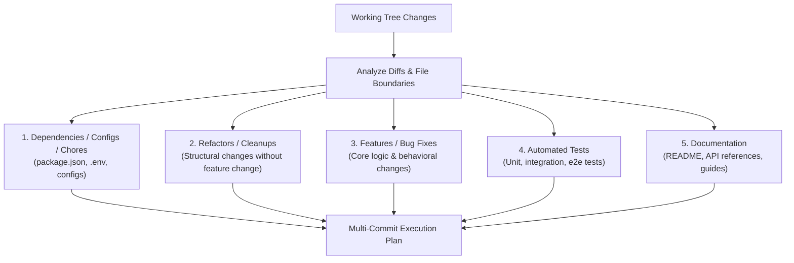

# Git Commit Skill

> "The extra time it takes to write a thoughtful commit message as a letter to your potential future self is extremely worthwhile. On large scale projects, documentation is imperative for maintenance."

This skill provides an authoritative guide and runbook for authoring meaningful, future-proof Git commit messages. It combines **Conventional Commits 1.0.0**, the **5-Step Journalist Method**, and **Atomic Commit Decomposition** to ensure every change in your repository is clean, isolated, and traceable.

---

## Philosophy & Core Principles

1. **Letter to Your Future Self**: Commits serve as an archive of changes. Write messages that will explain *why* a change was made when someone (including you) inspects `git blame` or `git log` six months from now.
2. **"Tell, Don't Just Show"**: The code diff shows *what* lines changed mechanically, but only your commit message can explain *why* the change was necessary, *what* problem it addresses, and *what impact* it has.
3. **Atomic Commits & Multi-Commit Generation**: Every commit must represent exactly one logical change. When multiple unrelated changes, features, refactors, tests, or fixes exist across the workspace, do NOT bundle them into a single monolithic commit. Instead, decompose them into a clean sequence of discrete, atomic commits.

---

## Anatomy of a Commit Message

### Basic Commit
Used for small, self-contained changes where the subject line is completely self-explanatory:
```bash
git commit -m "<type>(<scope>): <imperative subject>"
```

### Detailed Multi-Line Commit
Used whenever context, rationale, or breaking changes need to be documented:
```text
<type>[optional scope]: <description>

[optional body: explains why the change was needed and what effect it has]

[optional footer(s): BREAKING CHANGE, Closes #123, Refs JIRA-456]
```

In Git CLI:
```bash
git commit -m "<type>(<scope>): <imperative subject>" -m "<body explaining why and what>"
```

---

## The 5 Steps to Write Better Commit Messages

Follow these 5 rules for every commit:

| Step | Rule | Guidelines | Example |
| :--- | :--- | :--------- | :------ |
| **1** | **Capitalization & Punctuation** | When using Conventional Commits, use **all lowercase** for the type, scope, and description. **Never end the subject line with a period**. (For non-conventional commits, capitalize the first word and omit ending punctuation). | `feat(auth): add refresh token handler` *(not `feat(auth): Add refresh token handler.`)* |
| **2** | **Mood** | Use the **imperative mood** in the subject line. Think: *"If applied, this commit will `<subject>`"*. Give an order or command. | `Add fix for dark mode toggle state` *(not `Added fix` or `Fixing`)* |
| **3** | **Type of Commit** | Use standard Conventional Commit types to categorize the purpose of changes. | `feat`, `fix`, `chore`, `refactor`, `docs`, `style`, `test`, `perf`, `ci`, `build`, `revert` |
| **4** | **Length** | Keep the subject line **≤ 50 characters** ideally (hard limit 72). Wrap body paragraphs to **≤ 72 characters** per line. | Concise headline; detailed body |
| **5** | **Content (Journalist Method)** | Think like a journalist: answer **What** and **Why** (and the effect). Eliminate filler words (*though, maybe, I think, kind of*). Assume the reader lacks external ticket context. | `Add margin to nav items to prevent them from overlapping the logo` *(not `Add margin`)* |

---

## Conventional Commit Types Reference

Use these standard types:

- **`feat`**: A new user-facing or API feature.
- **`fix`**: A bug fix.
- **`chore`**: Maintenance tasks that don't modify `src` or test files (e.g., updating package dependencies, release configs).
- **`refactor`**: Code refactoring that neither fixes a bug nor adds a feature.
- **`docs`**: Documentation changes only (e.g., README, API docs).
- **`style`**: Changes that do not affect code logic (formatting, white-space, missing semicolons).
- **`test`**: Adding new tests or correcting existing tests.
- **`perf`**: Performance improvements.
- **`ci`**: Continuous integration configurations and workflow scripts.
- **`build`**: Changes affecting the build system or external build configurations.
- **`revert`**: Reverts a previous commit.

---


## The Journalist Framework ("Think Like a Journalist")

Before committing, ask these four journalistic questions:
1. **Why have I made these changes?** (Root cause / motivating problem)
2. **What effect have my changes made?** (Outcome / observable behavior change)
3. **Why was the change needed?** (Context / requirement / bug impact)
4. **What are the changes in reference to?** (Associated ticket, issue, or request)

### Filler Words Blacklist
Never use vague, hesitant language in commits:
- ❌ *"I think I fixed it this time"*
- ❌ *"Maybe this works"*
- ❌ *"Kind of fixed style issues"*
- ❌ *"Fixed bug on landing page though it might need review"*
- ❌ *"oops"*, *"wip"*, *"fixes"*

For a deep dive into the Journalist Framework and "Tell, Don't Just Show", see [Journalist Framework Reference](references/journalist-framework.md).

---

## Multi-Commit Decomposition Strategy (Ensuring Atomicity)

An **atomic commit** encapsulates a single, coherent change that can be understood, applied, or reverted independently without leaving the repository in a broken state.

### How to Decompose Changes into Multiple Commits

When inspecting your working tree, categorize modified and untracked files into logical boundaries:



### Logical Ordering Guidelines
Order your atomic commits logically so that the repository builds and passes tests at every intermediate commit:
1. **Prerequisites & Chores**: Dependency updates, configuration setup.
2. **Refactoring**: Internal restructuring preparing the ground for new logic.
3. **Core Feature / Fix**: The main behavioral implementation.
4. **Tests**: Test suites verifying the new behavior.
5. **Documentation**: User guides, reference manuals, or changelogs.

---

## Agent Step-by-Step Execution Runbook

When asked to create or assist with Git commits, follow this sequential procedure:

### Step 1: Inspect Status & Full Working Tree Diffs
Examine both staged and unstaged files across the workspace:
```powershell
git status --short
git diff
```

### Step 2: Assess Atomicity & Formulate Commit Plan
Determine whether the changes constitute a single atomic change or require multiple discrete commits:
- **Single Commit**: If all changes are tightly coupled to a single concern (e.g. only a bug fix and its direct test), formulate 1 commit.
- **Multiple Commits**: If changes span multiple distinct concerns (e.g. dependency bump + feature logic + tests + documentation), partition them into a **Multi-Commit Plan**.

For each planned commit, specify:
1. Assigned files
2. Commit type and scope
3. Draft subject line and body

*Example Multi-Commit Plan:*
> - **Commit 1/3**: `refactor(auth): decouple token verification from route handler`  
>   *Files*: `src/auth/jwt.ts`, `src/auth/types.ts`
> - **Commit 2/3**: `feat(auth): add biometric passkey authentication support`  
>   *Files*: `src/auth/passkey.ts`, `src/routes/login.ts`
> - **Commit 3/3**: `test(auth): add unit tests for passkey registration flow`  
>   *Files*: `tests/auth/passkey.test.ts`

If a spec file is modified, it should be committed with the same files that changed the spec.

### Step 3: Draft and Validate Commit Messages
For each commit in the plan, apply the 5-step checklist to confirm the subject line is well-formed before staging.

### Step 4: Stage and Execute Commits Sequentially
Stage only the relevant files for each atomic unit and execute each commit in planned sequence:
```powershell
# Commit 1
git add <files_for_commit_1>
git commit -m "<subject_1>" -m "<body_1>"

# Commit 2
git add <files_for_commit_2>
git commit -m "<subject_2>" -m "<body_2>"
```
*(On Windows PowerShell, use separate `-m` arguments to prevent newline escaping bugs).*

### Step 5: Verify Final Git History
Confirm all atomic commits were recorded correctly and the working tree is in the desired state:
```powershell
git log -n <number_of_commits> --stat
git status
```


